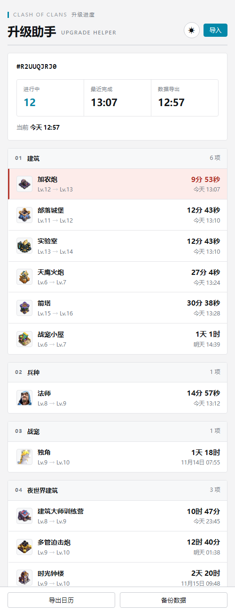
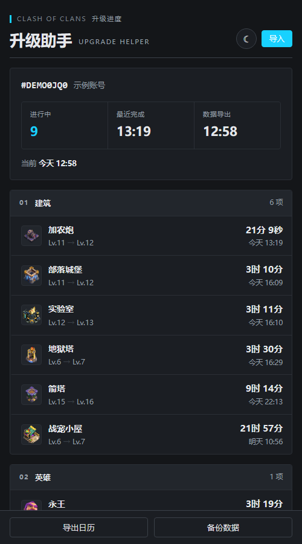

# 部落升级助手

导入游戏导出的玩家 JSON，一眼看清所有正在进行的升级，以及它们什么时候结束。

纯静态页面，没有后端，没有账号，不发送任何网络请求。数据只留在你自己的浏览器里。

深色主题：

## 功能

- 一次导入，列出建筑、英雄、兵种、法术、攻城机器、战宠、夜世界的全部在升级项
- 自动套用加速：工人助手、建筑工人药水、工人大餐、实验室药水、研究浓汤、宠物药水、时光钟楼
- 剩余时间每秒刷新，30 分钟内到期的高亮
- 导出 `.ics` 日历，每个项目在完成前 10 分钟提醒；重复导入不会产生重复事件
- 支持多个账号标签切换
- iOS 上可「读剪贴板」一键导入，不用手动粘贴
- 250 个建筑与兵种图标按资源 ID 匹配，缺图自动退回分类符号
- 浅色与深色两套外观，默认跟随系统，右上角可手动切换

## 导入数据

点右上角「导入」，三种方式任选：

| 方式 | 说明 |
|---|---|
| 读剪贴板 | 先在游戏查询工具里复制，点一下按钮。需要 https 页面和 iOS 16.4 以上 |
| 粘贴 | 直接粘进输入框，点「解析」 |
| 选择文件 | 选一个 `.json` 文件 |

数据里需要这几样：`tag`（玩家标签）、`timestamp`（导出时刻，秒）、各项升级里的 `timer`（剩余秒数）。

## 导出日历

点「导出日历」，得到一个 `.ics` 文件。在 iPhone 上点开，选择加入日历，队列里每一项会在结束前 10 分钟提醒。

事件 UID 由标签、项目、等级共同生成，同一个项目重新导出会覆盖旧事件。

## 数据备份

「备份数据」导出全部账号的 JSON。换设备或换浏览器时再读回来即可。

## 隐私

没有埋点、没有统计、没有远程请求。所有数据走 `localStorage`，清除浏览器数据即抹除。

## 许可

代码与文档按 MIT 发布，见 [LICENSE](LICENSE)。

`img/` 里的图标以及页面中的游戏名称、形象，版权归 Supercell，不包含在 MIT 范围内，仅作识别与展示用途。

## 免责声明

见 [DISCLAIMER.md](DISCLAIMER.md)。简单说：这是个人自用的非官方工具，与游戏厂商无关，图标素材版权归原厂，使用风险自负。

## 致谢

功能设计参考了社区里的「部落小工具」，本项目的实现是独立重写的。
